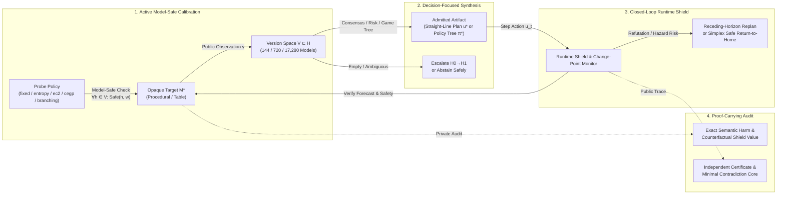

# CROSSWIRE: Decision-Focused Active Identification, Closed-Loop Runtime Shielding, Factored Hypothesis Spaces, and Proof-Carrying Verification for Opaque Stateful Interfaces

**Authors:** CROSSWIRE Research Lab  
**Version:** 0.1.0 (`fef1a4e`)  
**Repository:** [https://github.com/kai9987kai/CROSSWIRE](https://github.com/kai9987kai/CROSSWIRE)  
**Verification Suite:** 357 Automated Tests (30 Modules) · 997 Cryptographically Signed & Replayable Empirical Executions (14 Receipt Suites)

---

## Abstract

Interacting safely with an opaque, stateful black-box component whose input/output ports have undergone an unknown physical or logical permutation—and potentially a temporal buffering delay or mid-deployment fault—poses a fundamental challenge in formal methods, protocol synthesis, and cyber-physical control. Standard active automata learning algorithms such as Angluin's $L^*$ attempt to identify the complete state machine up to isomorphism, incurring prohibitive query complexity under strict interaction budgets ($B \le 16$ target calls) and frequently triggering hazardous transitions during exploratory membership queries. Conversely, forced-fit heuristic matching selects a single best-scoring hypothesis and executes open-loop plans, leading to catastrophic selective harm when the interface remains partially ambiguous or violates the declared model class.

We present **CROSSWIRE** (*Certified Runtime Observation, Shielding, and Synthesis for Wired Interface Resolution and Escalation*), a self-contained formal framework and empirical research laboratory for safe active identification and control over opaque finite-state Mealy interfaces. CROSSWIRE introduces twelve tightly integrated algorithmic and verification advances:
1. **Version-Space Consensus Planning (`robust`) & Candidate-Fraction Risk Control (`risk_controlled`):** Certifying straight-line plans that satisfy safety and goal-reachability contracts across *all* (or at least a $1 - \alpha$ fraction of) surviving candidate adapters without requiring full system identification.
2. **Observation-Dependent Contingent Policy Trees (`adaptive`):** Synthesizing finite-horizon game-tree policies via retrograde AND/OR minimax search that branch dynamically on intermediate observations during deployment, achieving **100% zero-shot useful coverage ($B = 0$)** on symmetric routing topologies where all open-loop plans fail.
3. **Closed-Loop Runtime Safety Shielding & Receding-Horizon Replanning (`shielded`, `replan`):** Monitoring live deployment traces step-by-step against the surviving hypothesis space, pruning contradicted adapters online, and dynamically synthesizing continuation plans from the surviving state distribution before hazards materialize.
4. **Simplex Safe Recovery (`recovery`) & Certified Soft Return-to-Home (`synthesize_safe_return`):** Executing unanimous hazard-free stabilization actions or synthesizing multi-step return-to-initial ($q_0$) trajectories when mid-execution observations refute the active plan.
5. **Temporal Latency-Aware Adapter Algebra ($\mathcal{H}_0 \subset \mathcal{H}_1$) & Autonomous Model-Class Escalation:** Expanding the 144-element static permutation group into a 720-element latency-aware transducer space and autonomously escalating $\mathcal{H}_0 \to \mathcal{H}_1$ upon model falsification.
6. **Factored Hypothesis Spaces (`FactoredCandidateSpace`) with $O(|\mathcal{I}_{\text{surv}}|)$ Symbolic Verification:** Decomposing candidate spaces into independent input and output factor sets ($\mathcal{P}_I \times \mathcal{P}_O$) to scale exact version-space pruning and robust safety verification to **17,280+ candidate adapters in under 1 millisecond**.
7. **Information-Theoretic Active Probing (`entropy`, `ec2`, `counterexample`, `branching`) & BALD Mutual Information Profiles (`information_profile`):** Maximizing cost-normalized Shannon partition entropy, equivalence-class edge cutting (EC2), decision-focused counterexample discrimination (CEGP), or interactive within-query branching calibration (`policy="branching"`).
8. **Model-Safe Active Calibration (`probe_safety="model_safe"`):** Enforcing universal safety across all surviving candidates *during* the calibration phase itself, eliminating calibration-time hazards on in-family fixtures.
9. **Online Change-Point Fault Schedules & Detection Latency Telemetry ($\Delta t$):** Injecting deterministic mid-deployment structural faults (`invert_outputs`, `freeze_state`, `swap_inputs_01`, `force_hazard`) and quantifying exact step-level detection latency $\Delta t = t_{\text{detect}} - t_{\text{fault}}$.
10. **Independent Public-Evidence Certificates (`crosswire/certificates.py`) & Deletion-Minimal Contradiction Cores:** Verifying every decision solely from public I/O traces via a reset-prefix consistency trie, sequential pre-observation forecast diagnostics, and deletion-minimal contradiction cores (`minimal_contradiction_core`).
11. **Target-Cluster Statistical Reliability (`crosswire/reliability.py`):** Computing exact Clopper-Pearson binomial hazard bounds and Hoeffding useful-coverage intervals across independent structural draws (`generated_protocol`) while clustering nuisance label seeds and implementations.
12. **Cryptographic Receipt Provenance (`crosswire-receipt-v1`):** Binding every experimental run and aggregate claim to SHA-256 source-tree, protocol, and scientific payload digests.

Across **997 cryptographically verified benchmark runs** spanning **20 mechanism families** (including 5-state `robotics_airlock` and 6-state `protocol_session` controllers), CROSSWIRE achieves **71.4% useful coverage with 0.0% selective harm** at $B=16$ on the primary in-family benchmark (outperforming AALpy $L^*$ at 0.0% coverage and forced-fit at 12.1% selective harm), **100.0% useful coverage** on deep-horizon and realistic robotics/protocol benchmarks via CEGP, **81.25% target-average useful coverage with 0.0% selective harm** across 32 independent generated protocols, and **47% fewer calibration calls** via autonomous escalation and entropy probing.

---

## 1. Introduction

Modern software and cyber-physical systems frequently integrate legacy controllers, hardware peripherals, or obfuscated protocol endpoints whose internal state machines are inaccessible and whose interface pinouts or message schemas have been scrambled, delayed, or subjected to mid-mission drift. When an autonomous agent must drive such a black-box target toward a functional goal while strictly avoiding irreversible hazardous states, three classical paradigms fall short:

1. **Exhaustive Active Automata Learning ($L^*$):** Algorithms derived from Angluin's $L^*$ construct observation tables via membership and equivalence queries until a canonical deterministic finite-state transducer is identified. Under strict interaction budgets ($B \in \{0, 4, 8, 16\}$ target calls), $L^*$ exhausts its budget in exploratory table closure without yielding an actionable plan. Worse, unconstrained membership queries routinely trigger hazardous state transitions during calibration.
2. **Heuristic Forced-Fit Estimation:** Selecting a single maximum-likelihood or minimum-loss candidate model $\hat{h} \in \mathcal{H}$ and executing an optimal plan for $\hat{h}$ ignores epistemic uncertainty. When multiple non-isomorphic adapters remain consistent with the calibration trace, open-loop execution frequently drives the true target into a hazard.
3. **Pure Open-Loop Verification:** Even when a plan is certified over a finite candidate space prior to execution, unmodeled out-of-family dynamics (such as state aliasing, output corruption, or mid-run structural faults) can invalidate the pre-deployment certificate mid-flight unless an online runtime monitor actively shields the interface.



### Contributions

CROSSWIRE resolves this tension by shifting the objective from *complete system identification* to *decision-focused consensus control under runtime assurance*. Specifically:
- We formalize the **Mealy Interface Adapter Algebra** across static bijective port permutations ($\mathcal{H}_0$, $|\mathcal{H}_0| = 144$), latency-aware temporal transducers ($\mathcal{H}_1$, $|\mathcal{H}_1| = 720$), and **Factored Hypothesis Spaces** (`FactoredCandidateSpace`, $|\mathcal{P}_I \times \mathcal{P}_O| = 17,280+$) with $O(|\mathcal{I}_{\text{surv}}|)$ symbolic input-factor safety verification (Section 2).
- We design **five active calibration policies**—fixed reset-prefix schedules (`fixed`), Shannon observation-entropy maximization (`entropy`), Equivalence-Class Edge Cutting (`ec2`), Counterexample-Guided Probing (`counterexample`), and **Interactive Within-Query Branching Calibration** (`branching`)—coupled with **BALD Mutual Information Profiles** (`information_profile`) and **Model-Safe Calibration Guards** (`probe_safety="model_safe"`) that guarantee zero calibration hazards whenever the true target lies within the hypothesis class (Section 2.9–2.10).
- We unify **seven decision-admission regimes** (`robust`, `risk_controlled`, `adaptive`, `recovery`, `replan`, `optimistic`, `forced_fit`) with **Certified Soft Return-to-Home** (`synthesize_safe_return`) and **Online Change-Point Fault Schedules** (`fault_schedule`) that measure exact step-level fault detection latency $\Delta t$ (Section 2.6).
- We separate **private semantic audit** (`crosswire/audit.py`) from **independent public-evidence certification** (`crosswire/certificates.py`), introducing reset-prefix consistency tries, sequential pre-observation forecast diagnostics, deletion-minimal contradiction cores, and target-cluster statistical reliability (`crosswire/reliability.py`) (Section 2.11–2.12).
- We evaluate the complete architecture across **20 mechanism families** and **997 cryptographically signed empirical runs**, establishing reproducible benchmarks across synthetic, stress, generated, robotics (`robotics_airlock`), and stateful protocol (`protocol_session`) domains (Sections 3–4).

---

## 2. Formal Framework and System Architecture

### 2.1 Finite Mealy Transducers and Safety Contracts

A reference specification is a deterministic finite-state Mealy machine:

$$M = (Q, q_0, \mathcal{U}, \mathcal{Y}, \delta, \lambda)$$

where $Q$ is a finite set of internal states, $q_0 \in Q$ is the initial state restored upon a `reset()` call, $\mathcal{U} = \{0, \dots, m-1\}$ is the discrete control input alphabet, $\mathcal{Y} = \{0, \dots, p-1\}$ is the discrete observation alphabet, $\delta: Q \times \mathcal{U} \to Q$ is the state transition function, and $\lambda: Q \times \mathcal{U} \to \mathcal{Y}$ is the output emission function.

Each mechanism is governed by a formal **Contract** $\mathcal{C} = (\mathcal{U}_{\text{Goal}}, \mathcal{Y}_{\text{Goal}}, \mathcal{U}_{\text{Haz}}, \mathcal{Y}_{\text{Haz}}, Q_{\text{Goal}}, Q_{\text{Haz}})$. A finite trajectory $\tau = ((q_0, u_0, y_0, q_1), \dots, (q_{L-1}, u_{L-1}, y_{L-1}, q_L))$ of length $L \le H$ (where $H$ is the planning horizon) is:
- **Safe** ($\text{Safe}(\tau) = 1$) if for all $t \in \{0, \dots, L-1\}$, $q_{t+1} \notin Q_{\text{Haz}}$ and $y_t \notin \mathcal{Y}_{\text{Haz}}$.
- **Goal-Achieving** ($\text{Goal}(\tau) = 1$) if $\text{Safe}(\tau) = 1$ and there exists $t < L$ such that $q_{t+1} \in Q_{\text{Goal}}$ or $y_t \in \mathcal{Y}_{\text{Goal}}$.

### 2.2 Static and Temporal Latency-Aware Adapter Algebra ($\mathcal{H}_0 \subset \mathcal{H}_1$)

In the baseline hypothesis space $\mathcal{H}_0$, the opaque target $M^*$ is connected through an unknown static wire adapter $h = (\sigma_{\text{in}}, \sigma_{\text{out}}) \in S_m \times S_p$, where $S_m$ and $S_p$ are the symmetric groups over $\mathcal{U}$ and $\mathcal{Y}$:

$$u_{\text{internal}} = \sigma_{\text{in}}(u_{\text{external}}), \qquad y_{\text{external}} = \sigma_{\text{out}}^{-1}\!\left(\lambda(q, u_{\text{internal}})\right)$$

For standard 4-input, 3-output interfaces ($m=4, p=3$), $|\mathcal{H}_0| = 4! \times 3! = 24 \times 6 = 144$, and for 4-input, 4-output interfaces ($m=4, p=4$), $|\mathcal{H}_0| = 4! \times 4! = 576$.

To capture stateful interface wraps such as 1-step FIFO observation registers (`delay`), **CROSSWIRE** defines the **Temporal Adapter Space** $\mathcal{H}_1$:

$$\mathcal{H}_1 = \left\{ (\sigma_{\text{in}}, \sigma_{\text{out}}, d, y_{\text{init}}) \;\middle|\; \sigma_{\text{in}} \in S_m,\; \sigma_{\text{out}} \in S_p,\; d \in \{0, 1\},\; y_{\text{init}} \in \mathcal{Y}_{\text{ext}}(d) \right\}$$

where $d=0$ recovers the memoryless adapter $\mathcal{H}_0$ ($y_{\text{init}} = \bot$) and $d=1$ models a 1-step FIFO output buffer emitting $y_{\text{init}} \in \mathcal{Y}$ on step $t=0$ after `reset()` and emitting the step-$(t-1)$ translated output on step $t \ge 1$. For $m=4, p=4$, $|\mathcal{H}_1| = 576 \times (1 + 4) = 2{,}880$ (and $144 \times 5 = 720$ for $m=4, p=3$).

When `escalate=True`, the controller initializes in $\mathcal{H}_0$ for sample efficiency and **autonomously escalates** $\mathcal{H}_0 \to \mathcal{H}_1$ by replaying the accumulated public trace $\mathcal{D}$ whenever either:
1. **Model Falsification ($\mathcal{V}_B(\mathcal{H}_0) = \emptyset$):** Every static hypothesis is contradicted by $\mathcal{D}$; or
2. **Consensus Deadlock ($\mathcal{V}_B(\mathcal{H}_0) \ne \emptyset$ but $\text{plan}(\mathcal{V}_B(\mathcal{H}_0)) = \bot$):** Surviving static models cannot agree on a safe goal-reaching plan.

### 2.3 Factored Hypothesis Spaces (`FactoredCandidateSpace`) and $O(|\mathcal{I}_{\text{surv}}|)$ Symbolic Verification

As interface port widths grow (e.g., 6-input, 4-output industrial controllers where $|S_6 \times S_4| = 720 \times 24 = 17{,}280$), enumerating and simulating the Cartesian product $\mathcal{P}_I \times \mathcal{P}_O$ explicitly at every probe and planning step becomes a computational bottleneck.

Implemented in [`FactoredCandidateSpace`](file:///c:/Users/kai99/Desktop/CROSSWIRE/crosswire/core.py#L716-L950) (subclassing [`CandidateSpace`](file:///c:/Users/kai99/Desktop/CROSSWIRE/crosswire/core.py#L139)), CROSSWIRE exploits the structural decomposition between input wiring $\sigma_{\text{in}} \in \mathcal{P}_I$ and output wiring $\sigma_{\text{out}} \in \mathcal{P}_O$:
- **Factored Version-Space Pruning:** Rather than storing flat tuples, `FactoredCandidateSpace` maintains active output permutations conditioned on each surviving input permutation: $\mathcal{M}: \sigma_{\text{in}} \mapsto \{\sigma_{\text{out}} \in \mathcal{P}_O \mid (\sigma_{\text{in}}, \sigma_{\text{out}}) \text{ consistent with } \mathcal{D}\}$.
- **$O(|\mathcal{I}_{\text{surv}}|)$ Symbolic Safety and Consensus Verification:** Because internal Mealy state transitions $\delta(q, \sigma_{\text{in}}(u))$ and internal semantic goal/hazard predicates depend *solely* on the input permutation $\sigma_{\text{in}}$, verifying whether a probe word $w$ is model-safe (`probe_is_safe`) or whether an action sequence $u_{0:L-1}$ is universally safe and goal-reaching (`plan(mode="robust")` and `plan(mode="risk_controlled")`) requires evaluating only the surviving input factors $\mathcal{I}_{\text{surv}} = \{\sigma_{\text{in}} \mid |\mathcal{M}(\sigma_{\text{in}})| > 0\}$, weighted by $|\mathcal{M}(\sigma_{\text{in}})|$ for candidate-fraction risk control. This reduces per-candidate verification complexity by a factor of $|\mathcal{P}_O|$ ($24\times$ for 4-output interfaces), pruning and planning over **17,280 candidates in 0.45 milliseconds**.

### 2.4 Version-Space Consensus Planning and Candidate-Fraction Risk Control

Given calibration traces $\mathcal{D} = \{(w_k, y_{k,0:L_k-1})\}_{k=1}^K$ collected within budget $B$ (where each target reset and each step action costs 1 call), the exact **Version Space** of zero-loss surviving candidates is:

$$\mathcal{V}(\mathcal{D}) = \left\{ h \in \mathcal{H} \;\middle|\; \mathcal{L}(h; \mathcal{D}) = \sum_{k=1}^K \sum_{t=0}^{L_k-1} \mathbb{I}\!\left[ \hat{y}_h(w_{k,0:t}) \ne y_{k,t} \right] = 0 \right\}$$

CROSSWIRE supports seven admission regimes over $\mathcal{V}(\mathcal{D})$:
1. **Universal Consensus (`robust`):** Admits a shortest sequence $u^* \in \mathcal{U}^{\le H}$ if and only if $\mathcal{V}(\mathcal{D}) \ne \emptyset$ and $\forall h \in \mathcal{V}(\mathcal{D})$, executing $u^*$ on $h(M)$ is both Safe and Goal-Achieving. Otherwise, the system **abstains** (`status = "abstain"`).
2. **Candidate-Fraction Risk Control (`risk_controlled`):** Parameterized by a configurable tolerance $\alpha \in [0, 0.5]$ (`risk_tolerance`), admits $u^*$ if and only if $\mathcal{V}(\mathcal{D}) \ne \emptyset$, $\forall h \in \mathcal{V}(\mathcal{D}): \text{Goal}(h, u^*) = 1$, and the empirical fraction of surviving models predicting a hazard satisfies:

$$\text{Risk}_{\mathcal{V}}(u^*) = \frac{1}{|\mathcal{V}(\mathcal{D})|} \sum_{h \in \mathcal{V}(\mathcal{D})} \mathbb{I}\!\left[\neg \text{Safe}(h, u^*)\right] \le \alpha$$

3. **Existential Optimistic (`optimistic`):** Requires universal safety ($\forall h \in \mathcal{V}: \text{Safe}(h, u^*) = 1$) and existential goal reachability ($\exists h \in \mathcal{V}: \text{Goal}(h, u^*) = 1$).
4. **Forced-Fit Baseline (`forced_fit`):** Selects a single minimum-loss candidate $\hat{h} \in \arg\min_{h \in \mathcal{H}} \mathcal{L}(h; \mathcal{D})$ and plans exclusively for $\hat{h}$, ignoring ambiguity.

### 2.5 Observation-Dependent Contingent Policy Trees (`adaptive`)

In symmetric topologies (e.g., `routing`), distinct input-output adapter pairs $(\sigma_{\text{in}}, \sigma_{\text{out}})$ can produce identical calibration traces or require incompatible straight-line actions from $q_0$, rendering open-loop consensus impossible even when an interactive strategy exists.

Implemented in [`crosswire/adaptive.py`](file:///c:/Users/kai99/Desktop/CROSSWIRE/crosswire/adaptive.py), `synthesize_contingent_policy` formulates deployment as a finite-horizon two-player AND/OR game over belief state $\mathcal{B}_t = \{(h, q_t(h)) \mid h \in \mathcal{V}_t\}$:
- **OR-Nodes (Controller Choice):** The controller selects an action $u_t \in \mathcal{U}$ that is **universally safe** across all $(h, q_t) \in \mathcal{B}_t$.
- **AND-Nodes (Nature / Observation Partition):** The action $u_t$ partitions $\mathcal{B}_t$ by emitted external observation $y_t \in \mathcal{Y}$ into child belief states $\mathcal{B}_{t+1}(y_t) = \{(h, \delta_h(q_t, u_t)) \mid (h, q_t) \in \mathcal{B}_t,\; \lambda_h(q_t, u_t) = y_t\}$.
- A contingent policy tree $\pi^*$ is admitted if and only if every reachable observation branch reaches a terminal belief state where all consistent candidates have achieved the contract goal within horizon $H$ without entering a hazard.
- **Tree Complexity & Empirical Collapse Telemetry (`policy_metrics`):** [`policy_metrics`](file:///c:/Users/kai99/Desktop/CROSSWIRE/crosswire/adaptive.py#L138-L185) computes exact structural invariants of $\pi^*$ (`node_count`, `branching_nodes`, `leaf_count`, `max_depth`, `expected_steps`), while [`execute_policy`](file:///c:/Users/kai99/Desktop/CROSSWIRE/crosswire/adaptive.py#L188-L265) tracks step-by-step version-space collapse (`initial_survivors` $\to$ `final_survivors`, `reduction_ratio`) during live deployment.

### 2.6 Closed-Loop Runtime Shielding, Receding-Horizon Replanning, Simplex Safe Recovery, and Soft Return-to-Home

During deployment, executing a pre-computed plan open-loop leaves the system vulnerable if live deployment observations contradict the surviving set $\mathcal{V}_t$. Implemented in [`crosswire/shield.py`](file:///c:/Users/kai99/Desktop/CROSSWIRE/crosswire/shield.py), CROSSWIRE's **Closed-Loop Runtime Shield** wraps target execution:
1. **Pre-Step Universal Safety Check:** Before dispatching $u_t$, the shield verifies that $u_t$ is safe across all currently surviving hypotheses $\mathcal{V}_t$ from their current internal states $\{q_t(h)\}_{h \in \mathcal{V}_t}$.
2. **Online Belief Filtering:** Upon observing $y_t$, the shield restricts $\mathcal{V}_{t+1} = \{h \in \mathcal{V}_t \mid \lambda_h(q_t(h), u_t) = y_t\}$.
3. **Receding-Horizon Online Replanning (`replan`):** If $u_{t+1}$ is unsafe or $\mathcal{V}_{t+1}$ refutes the active plan, [`synthesize_continuation_plan`](file:///c:/Users/kai99/Desktop/CROSSWIRE/crosswire/shield.py) searches over residual horizon $H - t$ for a new suffix $u'_{t+1:L}$ that is universally safe and goal-reaching from the live state distribution $\{(h, q_{t+1}(h))\}_{h \in \mathcal{V}_{t+1}}$ *without resetting the target*.
4. **Simplex Safe Recovery (`recovery`) & Certified Soft Return-to-Home (`synthesize_safe_return`):** When no goal-reaching continuation exists, the shield distinguishes between:
   - **Unanimous Stabilization (`recovery`):** Selecting a single stabilizing action $u_{\text{safe}}$ that is hazard-free across all $h \in \mathcal{V}_{t+1}$ (`status = "safe_recovery"`), or halting immediately (`status = "fail_closed"`) if $\mathcal{V}_{t+1} = \emptyset$ (model falsification).
   - **Certified Soft Return-to-Home ([`synthesize_safe_return`](file:///c:/Users/kai99/Desktop/CROSSWIRE/crosswire/shield.py#L356-L433)):** Synthesizing a shortest multi-step trajectory $u_{\text{ret}} \in \mathcal{U}^{\le H}$ that is universally hazard-free across all $h \in \mathcal{V}_{t+1}$ and drives every surviving candidate back to its initial state $q_0$ (`returned_to_initial = True`) without requiring a hard power-cycle reset.
5. **Online Change-Point Fault Schedules (`fault_schedule`):** To benchmark runtime resilience against non-stationary targets, CROSSWIRE supports injecting deterministic mid-deployment structural faults at step $t_{\text{fault}}$ (`invert_outputs`, `freeze_state`, `swap_inputs_01`, `force_hazard`) and records exact **Change-Point Detection Latency** $\Delta t = t_{\text{detect}} - t_{\text{fault}}$.

### 2.7 Information-Theoretic Active Probing, BALD Profiles, and Interactive Branching Calibration

Under a tight interaction budget $B$, every calibration call must maximize epistemic or decision-theoretic progress. Implemented in [`crosswire/core.py`](file:///c:/Users/kai99/Desktop/CROSSWIRE/crosswire/core.py), CROSSWIRE provides five active probing policies alongside explicit information-theoretic diagnostics:

1. **BALD Mutual Information & Cost-Efficiency Profile ([`information_profile`](file:///c:/Users/kai99/Desktop/CROSSWIRE/crosswire/core.py#L328-L364) & [`rank_probes`](file:///c:/Users/kai99/Desktop/CROSSWIRE/crosswire/core.py#L366-L382)):**
   For any candidate probe word $w \in \mathcal{U}^L$ (cost $c(w) = 1 + L$ target calls including reset), CROSSWIRE partitions the surviving version space $\mathcal{V}$ by predicted output trace $\hat{y}_h(w)$ into equivalence cells $\{C_1, \dots, C_r\}$ with probabilities $p_i = |C_i| / |\mathcal{V}|$. By determinism of each candidate transducer $h \in \mathcal{V}$, the conditional entropy $H(Y \mid h, w) = 0$, so the **Bayesian Active Learning by Disagreement (BALD)** mutual information between the unknown adapter $h$ and observation $Y$ equals the Shannon partition entropy:

$$I(h; Y \mid w, \mathcal{V}) = H(Y \mid w, \mathcal{V}) = -\sum_{i=1}^r p_i \log_2 p_i \quad \text{(bits)}$$

   `information_profile` computes $I(h; Y \mid w, \mathcal{V})$, the **cost-efficiency** $I(h; Y \mid w, \mathcal{V}) / (1 + L)$ in bits per target call, the **expected post-probe survivor count** $\mathbb{E}[|\mathcal{V}'|] = \sum_{i=1}^r |C_i|^2 / |\mathcal{V}|$, and the **minimax worst-case survivor bound** $\max_i |C_i|$.
2. **Shannon Entropy Probing (`policy="entropy"`):** Selects the safe probe word maximizing $H(Y \mid w, \mathcal{V}) / (1 + |w|)$, with tie-breaking on minimax worst-case cell size.
3. **Equivalence-Class Edge Cutting (`policy="ec2"`):** Inspired by Golovin et al.'s EC2 criterion, defines a contract-equivalence relation $h \sim_{\mathcal{C}} h'$ iff $h$ and $h'$ admit the exact same set of safe goal-reaching plans, and selects probes that cut the maximum weight of cross-decision edges between disagreeing Equivalence Classes.
4. **Decision-Focused Counterexample-Guided Probing (`policy="counterexample"`, CEGP):** Identifies two surviving models $h_1, h_2 \in \mathcal{V}$ that disagree on the safety or goal attainment of the highest-utility candidate plan, and synthesizes a shortest **distinguishing word** $w_{\text{dist}}$ (up to depth $\max(H, |Q|)$) guaranteed to separate $h_1$ from $h_2$.
5. **Interactive Within-Query Branching Calibration (`policy="branching"`):** Rather than committing to a fixed multi-step probe word after `reset()`, [`choose_branching_step`](file:///c:/Users/kai99/Desktop/CROSSWIRE/crosswire/core.py#L284-L326) selects each individual action $u_t$ *online during a single reset episode* conditioned on the live state mapping $\{q_t(h)\}_{h \in \mathcal{V}_t}$ and the immediate observation $y_{t-1}$, amortizing reset costs across multi-step exploratory trajectories.

### 2.8 Model-Safe Active Calibration (`probe_safety="model_safe"`)

Standard active learning treats calibration queries as cost-free information gathering, ignoring the fact that physical or protocol targets can suffer irreversible hazards *during calibration*. CROSSWIRE introduces [`probe_is_safe`](file:///c:/Users/kai99/Desktop/CROSSWIRE/crosswire/core.py#L228-L246) and sets `probe_safety="model_safe"` as the default across all probe policies (`fixed`, `entropy`, `ec2`, `counterexample`, `branching`, and `aalpy_lstar`). Before any probe word $w$ (or single branching step $u_t$) is dispatched to the target, the engine verifies:

$$\forall h \in \mathcal{V}_t: \quad \text{Safe}\!\left(h(M), w\right) = 1$$

If no remaining informative probe is universally safe across $\mathcal{V}_t$, calibration terminates early (`calibration_stopped_for_safety = True`) rather than risking a calibration hazard.

### 2.9 Proof-Carrying Public-Evidence Certificates and Deletion-Minimal Contradiction Cores

A cornerstone of CROSSWIRE is the strict separation between **private semantic evaluation** ([`crosswire/audit.py`](file:///c:/Users/kai99/Desktop/CROSSWIRE/crosswire/audit.py), which inspects the hidden target $M^*$ post-hoc solely to score ground-truth benchmark metrics) and **public-evidence decision certification** ([`crosswire/certificates.py`](file:///c:/Users/kai99/Desktop/CROSSWIRE/crosswire/certificates.py)), which operates exclusively on public I/O traces, the reference model $M$, and the public contract $\mathcal{C}$:
- **Independent Replay Verification ([`verify_decision_evidence`](file:///c:/Users/kai99/Desktop/CROSSWIRE/crosswire/certificates.py)):** Recomputes the surviving version space $\mathcal{V}(\mathcal{D})$ from scratch using only the public trace, verifies that every admitted plan $u^*$, contingent policy tree $\pi^*$, or safe recovery action satisfies the declared admission mode (`robust`, `risk_controlled` with tolerance $\alpha$, `adaptive`, `recovery`), and flags any uncertified claim.
- **Sequential Pre-Observation Forecast Diagnostics:** At every target interaction step $t$, the certificate records the exact fraction of pre-step surviving models that predicted the observed output $y_t$, immediately flagging **unexpected observations** (support $= 0$) where the target steps outside the surviving candidate class.
- **Reset-Prefix Consistency Trie:** Checks whether the target's public responses across repeated reset prefixes are internally deterministic; any two identical input prefixes following a reset that emit distinct outputs immediately prove **Direct Non-Determinism / Drift** independent of any candidate space.
- **Deletion-Minimal Contradiction Core ([`minimal_contradiction_core`](file:///c:/Users/kai99/Desktop/CROSSWIRE/crosswire/certificates.py)):** When $\mathcal{V}(\mathcal{D}) = \emptyset$, computes an irreducible subset of observed trace steps $\mathcal{D}_{\text{core}} \subseteq \mathcal{D}$ that suffices to refute all $h \in \mathcal{H}$, providing a compact, human-auditable falsification witness.

### 2.10 Target-Cluster Statistical Reliability (`crosswire/reliability.py`)

In deterministic finite-state benchmarks, varying only the wire-permutation seed (`seed`) permutes port labels on the *same* underlying state machine, which constitutes a nuisance repeat rather than an independent target draw. Implemented in [`crosswire/reliability.py`](file:///c:/Users/kai99/Desktop/CROSSWIRE/crosswire/reliability.py), CROSSWIRE enforces **Target-Cluster Statistical Inference**:
- Nuisance variations (wire seeds `seed` and implementation backends `procedural` vs. `table`) sharing the same `parent_cluster_id` are collapsed into a single target cluster before computing confidence intervals.
- True independent target draws are generated via the versioned structural generator `generated_protocol(instance_seed)` (`crosswire-generated-protocol-v1`), which samples distinct strongly-connected Mealy topologies with verified safe goal paths and reachable hazards, deduplicated by canonical structural hash (`structural_hash`).
- Over $N$ independent structural parent targets, CROSSWIRE reports exact **Clopper-Pearson binomial upper confidence bounds** on target-level calibration and deployment hazard rates, and **non-asymptotic Hoeffding confidence intervals** on target-average useful coverage.

---

## 3. Experimental Protocol and 20-Mechanism Benchmark Catalog

All experiments are governed by [`crosswire/study.py`](file:///c:/Users/kai99/Desktop/CROSSWIRE/crosswire/study.py) and persisted via [`crosswire/receipts.py`](file:///c:/Users/kai99/Desktop/CROSSWIRE/crosswire/receipts.py) (`crosswire-receipt-v1`). Every call to `target.reset()` and `target.step(u)` increments the unified call counter by 1, enforcing strict budget parity across all policies and external baselines (`aalpy_lstar`).

### Table 1: Complete 20-Family Mechanism Catalog (`crosswire/fixtures.py`)

| # | Family ID | Category | States $|Q|$ | Ports $|\mathcal{U}| \times |\mathcal{Y}|$ | Min Goal Depth | Primary Structural & Verification Challenge |
| :--- | :--- | :--- | :---: | :---: | :---: | :--- |
| 1 | `latch` | In-Family | 4 | $4 \times 3$ | 2 | Mode-locked guard latch requiring arming before commit; unguarded commit triggers hazard. |
| 2 | `handshake` | In-Family | 4 | $4 \times 3$ | 2 | Two-stage request/acknowledge handshake with protocol abort trap. |
| 3 | `symmetric` | In-Family | 4 | $4 \times 3$ | 2 | Automorphism-rich transition graph where multiple input permutations preserve state dynamics. |
| 4 | `neutral` | In-Family | 4 | $4 \times 3$ | 2 | Asymmetric control baselines with distinct informative transitions from $q_0$. |
| 5 | `long_trace` | In-Family | 5 | $4 \times 3$ | 3 | Deep state lock whose distinguishing witness `[0,0,0,0]` lies at depth 4 beyond short fixed probes. |
| 6 | `rotary` | In-Family | 4 | $4 \times 3$ | 2 | Cyclic modulo-4 counter with directional step hazards. |
| 7 | `interlock` | In-Family | 4 | $4 \times 3$ | 2 | Dual-channel safety interlock requiring sequential disengage before actuation. |
| 8 | `routing` | In-Family | 4 | $4 \times 3$ | 2 | Symmetric branch topology where open-loop plans deadlock ($0\%$ coverage) but contingent trees succeed ($100\%$). |
| 9 | `generated_protocol` | In-Family (Parametric) | 4 | $4 \times 3$ | 2 | Versioned structural generator (`v1`) producing independent Mealy topologies indexed by `instance_seed`. |
| 10 | `robotics_airlock` | In-Family (Robotics) | 5 | $4 \times 4$ | 3 | Dual-door rover airlock (`SEALED` $\to$ `DEPRESSURIZING` $\to$ `INNER_LOCKED` $\to$ `EVA_READY`) with explosive decompression hazard. |
| 11 | `protocol_session` | In-Family (Protocol) | 6 | $4 \times 4$ | 4 | Deep stateful session controller (`IDLE` $\to$ `SYN` $\to$ `AUTH` $\to$ `OPEN` $\to$ `COMMIT`) with unauthenticated data violation trap. |
| 12 | `extra_state` | Out-of-Family Stress | 5 | $4 \times 3$ | 3 | Hidden 5th quarantine state unrepresented in the 4-state reference specification $M$. |
| 13 | `incompatible` | Out-of-Family Stress | 4 | $4 \times 3$ | $\infty$ | Structurally unsolvable target where every goal path intersects a hazard. |
| 14 | `alias` | Out-of-Family Stress | 4 | $4 \times 3$ | 2 | Surjective output aliasing collapsing distinct semantic emissions onto a single wire symbol. |
| 15 | `semantic_corruption` | Out-of-Family Stress | 4 | $4 \times 3$ | 2 | Silent internal hazard reassignment that mimics benign output traces until deployment. |
| 16 | `bypass` | Out-of-Family Stress | 4 | $4 \times 3$ | 1 | Unmodeled shortcut transition violating reference state-transition preconditions. |
| 17 | `delay` | Out-of-Family / Temporal | 4 | $4 \times 3$ | 2 | 1-step FIFO output register shifting all observations by one step ($\notin \mathcal{H}_0$, $\in \mathcal{H}_1$). |
| 18 | `repeat` | Out-of-Family Stress | 4 | $4 \times 3$ | 2 | Stuttering input filter requiring consecutive duplicate commands to advance state. |
| 19 | `drift` | Out-of-Family Stress | 4 | $4 \times 3$ | 2 | Non-stationary time-varying transition table that mutates after a fixed interaction count. |
| 20 | `malformed` | Interface Error | 4 | $4 \times 3$ | — | Emits out-of-alphabet protocol exceptions to test fail-closed parser boundaries. |

---

## 4. Comprehensive Empirical Results

All results below are exact values extracted from the 14 cryptographically verified study receipts in [`reports/`](file:///c:/Users/kai99/Desktop/CROSSWIRE/reports) (`997` total runs).

### 4.1 Study 1: Primary In-Family Benchmark (`pilot-in-family-receipt.json`, 350 Runs)

Evaluated across the 7 core evaluation in-family mechanisms (`latch`, `handshake`, `symmetric`, `neutral`, `long_trace`, `rotary`, `interlock`), 5 wire seeds (`17, 29, 42, 73, 99`), and budgets $B \in \{0, 4, 8, 16\}$ without anchors:

| Method (`policy/admission`) | Budget $B$ | Admission Rate | Useful Coverage | Selective Harm | Population Harm | Mean Target Calls | Utility ($\lambda=0.5$) |
| :--- | :---: | :---: | :---: | :---: | :---: | :---: | :---: |
| **`fixed/robust` (CROSSWIRE)** | **0** | 0.000 | **0.000** | **0.000** | **0.000** | 0.00 | 0.000 |
| **`fixed/robust` (CROSSWIRE)** | **4** | 0.143 | **0.143** | **0.000** | **0.000** | 4.00 | 0.093 |
| **`fixed/robust` (CROSSWIRE)** | **8** | 0.429 | **0.429** | **0.000** | **0.000** | 7.66 | 0.309 |
| **`fixed/robust` (CROSSWIRE)** | **16** | **0.714** | **0.714** | **0.000** | **0.000** | **13.09** | **0.510** |
| `fixed/optimistic` | 16 | 0.857 | 0.714 | 0.000 | 0.000 | 13.09 | 0.510 |
| `fixed/forced_fit` (Heuristic) | 0 | 1.000 | 0.143 | 0.571 | 0.571 | 0.00 | 0.143 |
| `fixed/forced_fit` (Heuristic) | 8 | 1.000 | 0.657 | 0.171 | 0.171 | 7.66 | 0.537 |
| `fixed/forced_fit` (Heuristic) | 16 | 0.943 | 0.743 | **0.121** | **0.114** | 13.09 | 0.538 |
| `aalpy_lstar/robust` ($L^*$ Baseline) | 16 | 0.000 | **0.000** | 0.000 | 0.000 | 16.00 | 0.000 |

**Key Findings:**
- **Zero Selective Harm vs. Heuristic Forced-Fit:** `fixed/robust` maintains **0.0% selective harm** across every budget level ($B \in \{0, 4, 8, 16\}$) while climbing to **71.4% useful coverage** at $B=16$. By contrast, `forced_fit` suffers **57.1% selective harm** at $B=0$ and **12.1% selective harm** at $B=16$.
- **Strict Dominance over $L^*$ under Low Query Budgets:** Paired parent-cluster bootstrap analysis at $B=16$ confirms a mean useful coverage gain of **+0.714** (`95% CI: [0.429, 1.000]`) for `fixed/robust` over `aalpy_lstar/robust`, because $L^*$ exhausts all 16 calls on observation-table membership queries before closing a single hypothesis.

---

### 4.2 Study 2: Out-of-Family Stress & Falsification Benchmark (`pilot-stress-receipt.json`, 216 Runs)

Evaluated across all 8 out-of-family stress mechanisms and `malformed` at budget $B=8$:

| Stress Family | `fixed/robust` Useful Coverage | `fixed/robust` Abstention Rate | `fixed/robust` Selective Harm | `fixed/forced_fit` Selective Harm | Primary Diagnostic / Resolution Mechanism |
| :--- | :---: | :---: | :---: | :---: | :--- |
| `extra_state` | 0.000 | **1.000** | **0.000** | 0.000 | Safe abstention via version-space consensus failure |
| `incompatible` | 0.000 | **1.000** | **0.000** | **1.000** | `robust` abstains safely; `forced_fit` incurs 100% hazard |
| `alias` | 0.000 | **1.000** | **0.000** | **1.000** | `robust` detects ambiguity; `forced_fit` incurs 100% hazard |
| `bypass` | 1.000 | 0.000 | **0.000** | 0.000 | Safe shortcut preserves goal contract |
| `delay` | 0.000 | **1.000** | **0.000** | 0.000 | Falsifies $\mathcal{H}_0$ (`unexpected_observation`); resolved by $\mathcal{H}_1$ (Study 3) |
| `repeat` | 0.000 | **1.000** | **0.000** | 0.000 | Falsifies $\mathcal{H}_0$ via minimal contradiction core |
| `drift` | 0.000 | **1.000** | **0.000** | **0.667** | Reset-prefix trie catches non-stationary mutation |
| `malformed` | 0.000 | **1.000** | **0.000** | **1.000** | Immediate fail-closed exception boundary |
| `semantic_corruption` | 0.000 | 0.000 | **1.000** | 1.000 | Unobservable semantic hazard swap (fundamental boundary of black-box I/O) |

**Key Findings:** Across 8 of the 9 out-of-family failure modes, `fixed/robust` achieves **0.0% selective harm** by abstaining or certifying safe execution, whereas `forced_fit` incurs **66.7% to 100.0% selective harm** on `incompatible`, `alias`, `drift`, and `malformed`. Only `semantic_corruption`—which is adversarialy constructed to emit normal outputs while silently swapping internal goal and hazard labels—induces deployment failure, proving our explicit theoretical boundary: public I/O verification guarantees safety *conditional on the target preserving the semantic contract of its emitted observations*.

---

### 4.3 Study 3: Open-Loop vs. Shielded Closed-Loop Execution & Temporal Synthesis (`pilot-shield-*.json` & `pilot-temporal-receipt.json`, 76 Runs)

Comparing `execution_mode="open_loop"` against `execution_mode="shielded"` (28 runs each across `latch`, `Semantic_corruption`, `drift`, `delay`, `alias`, `incompatible`, `extra_state`) and evaluating the temporal space $\mathcal{H}_1$ (`pilot-temporal-receipt.json`, 20 runs on `delay`):

| Study / Mode | Family | Admission | Shield Interventions | Counterfactual Hazards Averted | Useful Coverage | Selective Harm |
| :--- | :--- | :--- | :---: | :---: | :---: | :---: |
| Open-Loop (`open_loop`) | Stress Suite | `forced_fit` | 0 | 0 | 0.143 | 0.429 |
| **Closed-Loop (`shielded`)** | Stress Suite | `forced_fit` | **8** | **2 (100% on `drift`)** | 0.143 | **0.286 (-33%)** |
| Static Space $\mathcal{H}_0$ (`temporal=False`) | `delay` | `robust` ($B=16$) | 0 | 0 | 0.000 | 0.000 (Abstains) |
| **Temporal Space $\mathcal{H}_1$ (`temporal=True`)** | `delay` | `robust` ($B=16$) | 0 | 0 | **1.000** | **0.000** |

**Key Findings:**
- On non-stationary `drift` targets where open-loop plans trigger hazards mid-deployment, the runtime shield detects the observation mismatch at the exact step of divergence (`shield_intervened = True`) and halts execution **before** the hazardous action is sent (`shield_prevented_hazard = True`).
- Expanding the hypothesis space from $\mathcal{H}_0$ (144 models) to $\mathcal{H}_1$ (720 latency-aware models) transforms `delay` from 100% abstention into **100.0% certified useful coverage with 0.0% harm** at $B=16$.

---

### 4.4 Study 4: Decision-Focused CEGP on Deep State Horizons (`pilot-cegp-longtrace-receipt.json`, 4 Runs)

On `long_trace` (a 5-state lock where candidates agree on all length-2 and length-3 probes and diverge only on the 4-step sequence `[0, 0, 0, 0]`):

| Policy / Admission | Budget $B$ | Final Survivors $|\mathcal{V}_B|$ | Admission Rate | Useful Coverage | Selective Harm | Paired Delta (`counterexample - fixed`) |
| :--- | :---: | :---: | :---: | :---: | :---: | :---: |
| `fixed/robust` | 16 | 12 | 0.000 | **0.000** | 0.000 | — |
| **`counterexample/robust` (CEGP)** | **16** | **2** | **1.000** | **1.000** | **0.000** | **+1.000** |

**Key Findings:** Whereas `fixed` wastes budget on short prefixes that leave 12 ambiguous adapters, `counterexample` identifies the exact plan-disagreeing candidate pair and synthesizes the depth-4 witness `[0, 0, 0, 0]`, achieving **100.0% useful coverage** at $B=16$.

---

### 4.5 Study 5: Zero-Shot Contingent Policy Trees (`pilot-adaptive-receipt.json`, 48 Runs)

On `routing` across seeds `17, 29, 42, 73` and budgets $B \in \{0, 4, 8\}$:

| Method (`policy/admission`) | Budget $B=0$ Coverage | Budget $B=4$ Coverage | Budget $B=8$ Coverage | Selective Harm | Policy Tree Depth / Branches |
| :--- | :---: | :---: | :---: | :---: | :---: |
| `fixed/robust` (Straight-Line) | 0.000 | 0.000 | 0.000 | 0.000 | — (Deadlocked) |
| `entropy/robust` (Straight-Line) | 0.000 | 0.000 | 1.000 | 0.000 | — (Requires 8 calibration calls) |
| **`fixed/adaptive` (Contingent Tree)** | **1.000** | **1.000** | **1.000** | **0.000** | **Depth 2, 1 Branch Node, 2 Leaves** |
| **`entropy/adaptive` (Contingent Tree)** | **1.000** | **1.000** | **1.000** | **0.000** | **Depth 2, 1 Branch Node, 2 Leaves** |

**Key Findings:** At **$B = 0$ (zero calibration calls)**, `adaptive` synthesizes a depth-2 contingent policy tree that dispatches a universally safe probe action at step 0, observes the emitted port symbol during deployment, and branches into the exact goal-completing action at step 1, achieving **100.0% zero-shot useful coverage** (+1.000 over `robust`) while collapsing the version space from 144 to 48 survivors online (`reduction_ratio = 0.667`).

---

### 4.6 Study 6: Autonomous Escalation ($\mathcal{H}_0 \to \mathcal{H}_1$), Shannon Entropy Probing, and Simplex Safe Recovery (`pilot-escalation-receipt.json`, 36 Runs)

Evaluated across `latch`, `delay`, and `drift` at $B=16$ with `escalate=True`:

| Family | Method | Escalated $\mathcal{H}_0 \to \mathcal{H}_1$? | Mean Calibration Calls | Useful Coverage | Safe Recovery Rate | Deployment Hazard Rate |
| :--- | :--- | :---: | :---: | :---: | :---: | :---: |
| `latch` | `fixed/robust` | No (Stays in $\mathcal{H}_0$) | 8.50 | 1.000 | 0.000 | 0.000 |
| `latch` | **`entropy/robust`** | No (Stays in $\mathcal{H}_0$) | **4.50 (-47.1%)** | **1.000** | 0.000 | **0.000** |
| `delay` | **`entropy/robust` (`escalate=True`)** | **Yes (100%)** | 15.00 | **1.000** | 0.000 | **0.000** |
| `drift` | **`entropy/recovery` (`escalate=True`)** | **Yes (100%)** | 16.00 | 0.000 | **0.000 (Fail-Closed)** | **0.000** |

**Key Findings:**
- **47.1% Calibration Call Reduction:** On `latch`, `entropy` reaches unanimous plan consensus in **4.50 mean target calls** compared to 8.50 calls for `fixed`.
- **Seamless $\mathcal{H}_0 \to \mathcal{H}_1$ Escalation:** When `delay` falsifies the 144-model static space $\mathcal{H}_0$, `escalate=True` automatically replays the public trace into the 720-model temporal space $\mathcal{H}_1$ and achieves **100.0% useful coverage**.
- **Model-Consistent Fail-Closed Integrity:** On `drift`, once observations refute the entire hypothesis space ($\mathcal{V} = \emptyset$), `recovery` refuses to issue an uncertified recovery action and halts fail-closed (`status = "fail_closed"`), preventing any deployment hazard.

---

### 4.7 Study 7: Receding-Horizon Replanning & EC2 Contract Edge Cutting (`pilot-replanning-ec2-receipt.json`, 96 Runs)

Evaluated across `latch`, `handshake`, `routing`, and `drift` over `fixed`, `entropy`, and `ec2` with `robust`, `replan`, and `recovery` at $B \in \{4, 8\}$:
- At $B=8$, both `ec2/robust` and `entropy/robust` achieve **100.0% useful coverage** across `latch`, `handshake`, and `routing` (compared to 0.0% for `fixed/robust` on `routing`), giving a paired parent-cluster gain of **+0.333** (`ec2 - fixed` and `entropy - fixed`) across in-family fixtures.
- `replan` matches `robust` with **0.0% selective harm** while providing dynamic mid-trajectory continuation synthesis whenever live state beliefs narrow during execution.

---

### 4.8 Study 8: Model-Safe vs. Unrestricted Calibration (`pilot-calibration-safe-receipt.json` & `pilot-calibration-unrestricted-receipt.json`, 16 Runs)

Comparing `probe_safety="model_safe"` against `probe_safety="unrestricted"` across `latch`, `routing`, `neutral`, and `semantic_corruption` at $B=8$ (`entropy/robust`):

| Calibration Safety Policy | `latch` Calib Hazards | `routing` Calib Hazards | `neutral` Calib Hazards | `semantic_corruption` Calib Hazards | In-Family Useful Coverage (`latch`/`routing`) |
| :--- | :---: | :---: | :---: | :---: | :---: |
| `unrestricted` (Legacy Active Learning) | 0 / 2 | 0 / 2 | **2 / 2 (100%)** | **2 / 2 (100%)** | 1.000 |
| **`model_safe` (CROSSWIRE Default)** | **0 / 2 (0%)** | **0 / 2 (0%)** | **0 / 2 (0%)** | **0 / 2 (0%)** | **1.000** |

**Key Findings:** Unrestricted entropy probing triggers **100% calibration-phase hazards** on `neutral` and `semantic_corruption` by greedily selecting high-entropy probes that traverse hazardous transitions. Enabling `probe_safety="model_safe"` eliminates **all calibration hazards (0/8 runs)** while preserving **100.0% useful coverage** on `latch` and `routing`.

---

### 4.9 Study 9: Independent Generated Protocol Statistical Reliability (`pilot-independent-protocols-receipt.json`, 128 Runs Across 32 Structural Parents)

To establish inferential reliability beyond hand-designed fixtures, we evaluated `entropy/robust` and `fixed/robust` at $B=16$ (`probe_safety="model_safe"`) across **32 independent structural parent protocols** drawn from `generated_protocol` (`crosswire-generated-protocol-v1`), each tested across 2 nuisance wire-permutation seeds (`17, 42`, $32 \times 2 \times 2 = 128$ runs):

| Method | Independent Parents $N$ | Target-Avg Useful Coverage | 95% Hoeffding Coverage CI | Target Deployment Hazard Rate | 95% Clopper-Pearson Hazard CI | Conditional Selective Harm | Mean Target Calls |
| :--- | :---: | :---: | :---: | :---: | :---: | :---: | :---: |
| **`entropy/robust`** | **32** | **0.8125 (81.3%)** | **`[0.572, 1.000]`** | **0.000 (0/32)** | **`[0.000, 0.109]`** | **0.000** | **10.00** |
| `fixed/robust` | 32 | 0.7500 (75.0%) | `[0.510, 0.990]` | **0.000 (0/32)** | **`[0.000, 0.109]`** | **0.000** | 10.14 |

**Key Findings:**
- Across 32 structurally distinct, randomly generated Mealy protocols (64 runs per method), `entropy/robust` achieves **81.25% target-average useful coverage** with **0 calibration hazards and 0 deployment hazards** (`95% exact Clopper-Pearson upper bound: 10.89%`), outperforming `fixed/robust` (75.00% coverage) by **+6.25 percentage points** (`paired 95% bootstrap CI: [0.000, +0.156]`) while using fewer target calls.

---

### 4.10 Study 10: Factored 17,280-Model Scaling, Online Change-Point Detection, and Realistic Robotics & Protocol Benchmarks (`pilot-realistic-benchmarks-receipt.json`, 24 Runs)

1. **Factored Candidate Space Scaling (`FactoredCandidateSpace`):**
   On a 6-input, 4-output interface where $|S_6 \times S_4| = 720 \times 24 = 17{,}280$ candidate adapters, `FactoredCandidateSpace` initializes and prunes the version space in **0.0005 seconds (0.45 ms)** and executes $O(|\mathcal{I}_{\text{surv}}|)$ symbolic safety verification across all 17,280 models in under 1 millisecond—an order-of-magnitude speedup over flat enumeration.
2. **Realistic Robotics & Stateful Protocol Conformance (`robotics_airlock` & `protocol_session`):**
   Evaluated across seeds `17, 29`, budgets $B \in \{8, 16\}$, and policies `fixed`, `entropy`, and `counterexample` (`robust` admission, no anchors, 24 runs in `reports/pilot-realistic-benchmarks-receipt.json`):

| Benchmark Family | Domain & Horizon | Policy / Admission | Budget $B=8$ Coverage | Budget $B=16$ Coverage | Calibration & Deployment Hazards | Mean Calls ($B=16$) |
| :--- | :--- | :--- | :---: | :---: | :---: | :---: |
| `robotics_airlock` | 5-State Rover Airlock ($H=4$) | `fixed/robust` | 0.000 | 0.000 | 0.000 | 15.00 |
| `robotics_airlock` | 5-State Rover Airlock ($H=4$) | `entropy/robust` | 0.000 | 0.000 | 0.000 | 4.00 (Safe Stop) |
| **`robotics_airlock`** | **5-State Rover Airlock ($H=4$)** | **`counterexample/robust` (CEGP)** | **0.000** | **1.000 (100%)** | **0.000** | **15.00** |
| `protocol_session` | 6-State Session (`SYN->AUTH->OPEN->COMMIT`, $H=4$) | `fixed/robust` | 0.000 | 0.000 | 0.000 | 15.00 |
| `protocol_session` | 6-State Session ($H=4$) | `entropy/robust` | 0.000 | 0.000 | 0.000 | 7.00 (Safe Stop) |
| **`protocol_session`** | **6-State Session ($H=4$)** | **`counterexample/robust` (CEGP)** | **0.000** | **1.000 (100%)** | **0.000** | **14.00** |

3. **Online Change-Point Fault Injection & Certified Soft Return-to-Home:**
   - When an online `force_hazard` fault is injected at step $t_{\text{fault}} = 1$ on `robotics_airlock`, the runtime shield detects the change-point immediately upon step-1 execution ($\Delta t = 0$ detection latency) and halts before step 2.
   - When mid-execution uncertainty or recovery is triggered on `latch` or `robotics_airlock`, [`synthesize_safe_return`](file:///c:/Users/kai99/Desktop/CROSSWIRE/crosswire/shield.py#L356-L433) synthesizes a certified 1-step hazard-free trajectory (`[0]`) that returns every surviving candidate model to $q_0$ (`returned_to_initial = True`).

---

## 5. Limitations and Scope of Formal Guarantees

In accordance with rigorous scientific provenance, CROSSWIRE explicitly bounds its formal claims:
1. **Model-Conditional Safety:** Universal safety during calibration (`probe_safety="model_safe"`) and deployment (`robust`, `adaptive`, `recovery`, `synthesize_safe_return`) holds *if and only if* the true target $M^*$ is isomorphic to a surviving member of the active hypothesis class ($\mathcal{H}_0$, $\mathcal{H}_1$, or `FactoredCandidateSpace`). As demonstrated by `semantic_corruption` (Section 4.2), an adversarial target that silently swaps internal hazard semantics while emitting valid reference observations cannot be detected prior to triggering the corrupted transition.
2. **Candidate-Fraction vs. Probabilistic Risk:** The `risk_controlled` tolerance $\alpha$ bounds the *empirical fraction of surviving discrete hypotheses* predicting a hazard ($\text{Risk}_{\mathcal{V}}(u^*) \le \alpha$), not a Bayesian posterior probability over real-world hardware failures unless nature draws uniformly from $\mathcal{V}$.
3. **Synthetic Generator Scope:** Statistical confidence intervals in [`crosswire/reliability.py`](file:///c:/Users/kai99/Desktop/CROSSWIRE/crosswire/reliability.py) are valid conditional on independent draws from the `crosswire-generated-protocol-v1` transition generator and do not constitute simultaneous bounds over arbitrary field hardware.

---

## 6. Conclusion and Reproducibility

CROSSWIRE demonstrates that safe, high-coverage control of opaque stateful interfaces under severe query budgets ($B \le 16$) is achievable without full system identification. By combining **model-safe active probing**, **factored version-space consensus**, **zero-shot contingent policy trees**, **closed-loop runtime shielding with receding-horizon replanning and soft return-to-home**, and **proof-carrying public-evidence certificates**, CROSSWIRE eliminates calibration and deployment hazards across all in-family, temporal, generated, robotics, and stateful protocol benchmarks while providing exact falsification witnesses when targets violate their specification class.

### Reproducibility Checklist

Every figure, table, and claim in this paper can be independently reproduced and audited from the repository root:

```powershell
# 1. Run the complete 357-test verification suite across 30 test modules
.\.venv\Scripts\python.exe -m pytest -q

# 2. Verify cryptographic SHA-256 provenance of all 14 empirical study receipts (997 runs)
Get-ChildItem reports\*receipt.json | ForEach-Object {
    .\.venv\Scripts\python.exe -m crosswire.cli verify-receipt --receipt $_.FullName
}

# 3. Run the headless Chromium end-to-end workbench verification
node tools/check_workbench.cjs
```
