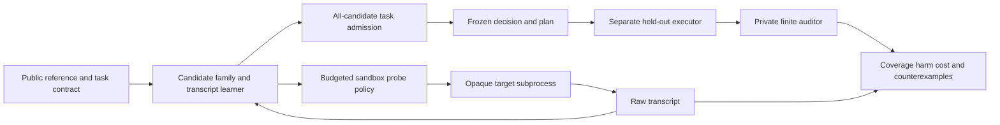

# CROSSWIRE: behavioral interoperability under ambiguous interfaces

Date: 22 October 2026. Status: proposed design for user review; implementation has not started. Location: `C:\Users\kai99\Desktop\CROSSWIRE`. The existing NEUROGRAFT checkout is a separate project.

## Intent and success

The user requested a distinct new experimental research lab informed by all 26 supplied repositories and current research, and explicitly required a new folder. The chosen purpose is a measurable research instrument. CPU-local execution, one deep mechanism, reproducible comparisons and explicit evidence limits are working constraints inferred from this request and prior project lessons.

Success for the first build is an operational lab that can answer a narrow question, reproduce its experiments, and expose a failure or negative result honestly. It is not defined as confirming the hypothesis.

**Research question:** When can finite observations justify connecting a known reference interface to an independently implemented target with unknown action and observation meanings, and when must the connector retain ambiguity or decline the connection?

**Candidate mechanism:** preserve every interface mapping consistent with the acquired behavior, rather than selecting one best-fitting mapping. Permit a bounded task plan only when it satisfies the public contract under every surviving interpretation. Otherwise acquire an informative sandbox probe or abstain.

The eventual practical motivation is detecting semantic mistakes between independently developed controllers, simulators and tools before composition. The first build tests a finite synthetic version, not arbitrary real services or neural models.

## Why this direction

| Direction considered | Strength | Limitation | Decision |
|---|---|---|---|
| Behavioral interoperability / CROSSWIRE | Concrete portfolio failures; finite ground truth; distinct interface-identification question; feasible CPU experiments | Exact claims rely on small declared models; scaling is unknown | Recommended first project |
| Independent-implementation replication lab | Tests whether conclusions survive different implementations | More evaluator than candidate architecture; large effort to make scientifically comparable implementations | Keep as a validation principle within CROSSWIRE |
| Evolving multiscale artificial-life/world-model platform | Strong visual potential and rich dynamics | Heavy overlap with Genesis, Fly, MOLT, Poseidon and NEUROGRAFT; hard to isolate mechanism value | Defer |

Two inspected failures motivate the narrow scope. Poseidon's corrected observation-schema assay records episode progress being mistaken for exposure despite a valid observation shape. Universal Modder explicitly documents a guest-camera oracle that bypasses the unverified host-to-guest transform. Their pinned sources and exact limitations are in the repository reviews. Neither example proves CROSSWIRE could have fixed the original software.

This project does not merge repository code or models. Lessons inform a separately authored instrument. Code/data/assets with unclear or different reuse terms are not dependencies of the first build.

## First-build model and observable access

Use deterministic finite-state transducers, initially three input symbols and four output symbols. A public frozen reference transducer defines the consumer interface. The target is independently implemented using a different execution path and held behind a callable boundary.

The learner is given only:

- The public reference model and task contract.
- Opaque target input/output alphabet IDs and their sizes.
- A sandbox `reset` and `step` interface with complete raw response traces.
- An explicit probe budget, maximum plan horizon and optional public anchor observations.

The learner is not given target internal states, transition code, ground-truth permutation, private goal/hazard labels, evaluation traces, family labels or generator seeds. Public opaque IDs are randomly assigned independently of meaning. Internal candidate IDs and tie-breaking order carry no target information.

Every calibration sequence begins from a sandbox reset. Reset semantics and whether the reset emits an observation are fixed in the schema. Any reset or step failure is recorded and charged, and no learner reaches around the interface to inspect target internals. Reference-model computations are separately counted. A subprocess boundary with a narrow JSON protocol makes this data flow auditable; it is not a guarantee against an adversary reading local source files.

The core v0.1 assumptions are complete deterministic stationary Mealy behavior, exact finite symbols, known alphabet sizes, and a reliable reset to one fixed state. Reset acknowledgement is outside the permuted output alphabet. No timing, state identifiers or incidental metadata enter the learner. Unit action costs are assumed unless explicit observable costs are added. Temporal delay, drift, noninvertible sensing and hidden extra state are assumption-violation experiments. They are not quietly treated as supported permutation mappings. Bounded temporal adapters are a later model extension after the stationary core is measured.

## Formal meaning of an adapter and a task

An adapter is a pair of bijections: one maps target inputs to reference inputs, and one maps reference outputs to target outputs. For three inputs and four outputs, the finite candidate family contains `3! * 4! = 144` maps. State relabeling is unnecessary at runtime: candidate source states are tracked by replaying the observed raw target input history through the mapped reference inputs.

Each candidate predicts raw target output traces. After calibration data D, the survivor set V(D) contains exactly the candidates whose raw predictions match all acquired traces and supplied anchors. For a deterministic realizable target, this is exact candidate elimination, not a calibrated probability distribution. No confidence percentage is assigned by dividing survivor counts.

For a request contract C, enumerate fixed open-loop target input words of lengths 1 through H, each beginning from reset. Under each candidate, translate the word into reference inputs and evaluate C on the resulting semantic reference trace. A word is permitted only if C holds under every surviving candidate. Use shortest length then lexicographic opaque-symbol order to choose among permitted words. A candidate remains fixed across the whole word; it cannot change between steps. Planning and execution run the complete word without early stopping. If V is empty, no plan is admitted. Feedback policies and plans from arbitrary live histories are outside v0.1.

The v0.1 contract is finite and explicit: reach a specified semantic terminal outcome within H actions while avoiding a specified semantic hazard on every prefix. Goal and hazard are defined by the public reference contract; a target's actual correspondence is retained privately for evaluation. Output symbols may include behaviorally symmetric terminals with different consumer meanings. Anchors, when provided, explicitly relate observable target symbols to contract semantics and their cost is recorded.

This prevents a circular benchmark in which the candidate's own output relabeling defines whether its connection succeeded. The held-out auditor judges actual target goal/hazard meaning independently of the learned map.

The all-candidate admission rule is conditionally sound only when the true interpretation and target behavior are covered by the surviving family and the reference contract is correct. Under that assumption, zero contract violations is a mathematical consequence of the rule. It is a software invariant to verify, not a new empirical discovery. The research questions are how much useful coverage it obtains, how much evidence it costs, when it is overly conservative, and how it fails when its assumptions are violated.

## Three kinds of ambiguity

Keep separate counts and statuses for:

1. **Syntactic ambiguity:** several different mapping objects remain.
2. **Observational ambiguity:** candidates predict indistinguishable raw behavior under the allowed reset/probe interface. Product-state search can establish this for the finite candidate models.
3. **Contract ambiguity:** surviving interpretations disagree about a goal/hazard or an admissible task plan.

Several different maps may still permit the same requested plan. Requiring a unique map would waste useful connections. Conversely, two maps may predict the same raw trace for every possible probe but assign different semantic goals. No amount of the same ungrounded behavioral data resolves that ambiguity; a new anchor or a weaker task is required.

An example fixture has two opaque terminal signals and a reference automorphism that swaps them together with two actions. The raw input/output behavior is compatible with two semantic interpretations. If one interpretation calls a terminal a goal and the other calls it a hazard, calibration without an anchor cannot justify a goal-directed connection. A separate fixture changes only neutral symbols so both interpretations permit the same goal plan.

There is a stronger limit outside the declared family: an accepted target and a semantic-corruption target can expose exactly the same raw traces while their private goal/hazard meanings differ. No allowed behavioral probe can distinguish that pair. Include it as an explicit impossibility control, not a case the method is expected to detect. For aliased outputs, the private auditor scores pre-alias semantic events rather than attempting to infer lost meanings from emitted symbols.

## Status and error model

| Learner status | Meaning |
|---|---|
| `IDENTIFIED` | One candidate map remains; task admission still requires its contract check |
| `TASK_ADMISSIBLE` | Multiple maps remain but a bounded word satisfies the requested contract under all of them |
| `NEEDS_EVIDENCE` | Current interpretations disagree and a distinguishing probe is available within the allowed interface |
| `UNRESOLVED` | No admissible word or no available budget/probe; no universal impossibility claim |
| `FAMILY_CONTRADICTED` | All candidates are inconsistent with observed behavior/anchors |
| `INTERFACE_ERROR` | Malformed output, reset/step failure, timeout or protocol violation |

`FAMILY_CONTRADICTED` means incompatible with the declared mapping class and acquired evidence. It does not prove no possible adapter exists. A private finite auditor may additionally report `NO_MAP_IN_CLASS` after exhaustive comparison over the declared class. It must state the class, state bounds and comparison method. “No safe word within H” is not the same as “no map in class.”

Admission always binds the reference, contract, horizon, target/version, anchor set and calibration transcript. Assumption violations invalidate its scope. A version/hash change produces a new session. Silent behavioral drift cannot be guaranteed detectable before its first adverse effect; the stress study must report that limitation and detection delay.

## Probe policy and decisive comparisons

The candidate policy chooses a bounded raw target input sequence that distinguishes surviving predictions, weighting disagreement by its relevance to the requested contract and dividing by actual reset/step cost. For each survivor a, compute S_a, its set of contract-satisfying deployment words within H. For each candidate pair a,b use weight `|S_a symmetric_difference S_b| / max(1, |S_a union S_b|)`. Score a probe q by the sum of these weights over pairs predicting different complete raw responses to q, divided by `1 + length(q)` (one reset plus its steps). Choose maximal score, then shortest probe and lexicographic opaque symbols. Task-agnostic discrimination uses the same formula with every pair weight equal to one. If every relevant pair is observationally inseparable, report unresolved rather than manufacturing informative evidence.

The initial probe pool is all raw input words of lengths 1 through 3 (39 words); deployment H is 4 (120 words). Both are public configuration values frozen before evaluation. All candidate simulation/search work is counted. The probe vocabulary is fixed; this is not an evolving assay grammar or another Mnemorph compiler.

Factor probe selection and admission so a benefit cannot be attributed to the wrong component:

| Probe policy | Admission policy |
|---|---|
| Fixed bounded conformance bank | One-best map; unique-map-only; all-candidate task rule |
| Uniform random probes | Same three admission rules |
| Task-agnostic disagreement probes | Same three admission rules |
| Contract-relevant disagreement probes | Same three admission rules |

Also include identity/no repair, a best-fit functional/transition alignment, always-abstain, and a true-map oracle diagnostic. The best-fit alignment minimizes the number of mismatched raw output symbols across the acquired reset traces over all 144 candidate maps, with fixed public candidate ordering to break ties. It chooses a shortest contract-satisfying word under that single map; no feasible word means abstention. Record its residual error even when every map has nonzero error. The survivor-only one-best ablation instead abstains on an empty survivor set and otherwise picks one consistent map. This separates forced fitting under misspecification from a commitment among equally consistent interpretations. All baselines receive identical calibration opportunities and total system-call budgets. They cannot access hidden state, true maps or an exact equivalence oracle.

Include a pinned AALpy L-star baseline with a budget-limited random-word conformance oracle and the same target access. It learns a raw target transducer. After a complete hypothesis is returned, compare its full finite behavior with each of the 144 mapped reference models by product search; retain behaviorally equivalent maps also consistent with the actual transcript, then apply the same all-candidate bounded task rule. An empty resulting set yields unresolved. If the call budget expires during model construction and no complete model is returned, abstain and retain all charged calls; do not fabricate a partial model or grant an uncharged finish. Exhausting an approximate oracle without a counterexample is reported as empirical completion, never exact target equivalence. Learning, conformance probes, model comparison and adapter planning are all counted. An exact-equivalence-assisted learner may be displayed only as a privileged diagnostic. Neural ridge/stitching baselines become mandatory if a later phase makes claims about neural representations; discrete one-hot point alignment in v0.1 does not reproduce ICML or ICLR stitching results.

## Benchmark families

The first fixture bank has separate public development families and frozen evaluation implementations:

- Identifiable relabelings with a short distinguishing trace.
- Mappings that remain different but agree on the requested contract.
- Finite-budget ambiguous pairs that more probing can resolve.
- Globally observationally equivalent candidate interpretations requiring a semantic anchor.
- A structurally different target for which no map in the chosen class exists.
- Alias/extra-state targets that can pass shallow calibration and fail a longer task.
- A bypassing-oracle negative control: a downstream check passes while the actual connecting path is wrong.
- An explicit malformed-interface family to verify construction, protocol acceptance and task success are separate.

Delay/repeat, post-calibration drift, sign/scale and coordinate-frame mismatches enter a secondary stress suite as out-of-family conditions. Report them separately. Do not relabel a deliberate unsupported mismatch as a failed supported permutation algorithm.

Use at least two target implementations: a table-driven engine and separately written procedural engines from the abstract task descriptions. Sharing a parser/protocol is acceptable; reusing one transition table behind two wrappers is not independent implementation. An additional held-out implementation author or external contributor is needed before claiming independent replication. Two implementations within one project establish implementation diversity only.

## Evaluation protocol and falsification

Start with a transparent exploratory pilot using approximately 4-6 reachable states and calibration action caps 0, 4, 8, 16 and 32, with resets counted separately and in total calls. Select final budgets, horizons and baseline settings on development families only, then save a protocol/source/configuration hash before the main evaluation. Public frozen evaluation fixtures are a holdout against tuning in this run, not a secrecy guarantee.

The statistical unit is an underlying semantic target instance with an explicit parent instance ID. Contracts, label permutations, repeated words, repeated seeds and alternate implementations derived from that same instance share its cluster; they are not independent replicates. Compare methods on the same clusters and resample/permutate whole clusters. Summarize families separately; few hand-authored families do not support a broad population claim. Log failures and timeouts as outcomes; never silently remove them.

Report all of the following together:

- Useful coverage: successful admitted requests divided by all requests.
- Useful coverage conditional on private oracle feasibility within the same open-loop horizon; oracle-infeasible requests are also reported separately.
- Admission coverage: admitted requests divided by all requests.
- Selective harm: contract violations divided by admitted requests; undefined when none are admitted.
- Total-population harm: contract violations divided by all requests.
- Goal failures, hazard-prefix violations, abstentions and interface failures separately.
- Raw survivor count, observational classes and contract classes.
- Target reset/step calls, source simulation steps, candidate expansions, CPU time and memory.
- Risk versus coverage and utility across prespecified abstention-cost settings.
- Out-of-family false admissions and, in the secondary suite, drift detection delay.

Primary empirical comparison: useful coverage and acquisition cost of contract-relevant probing versus task-agnostic disagreement, random and fixed probing at the same system-call cap, using the same all-candidate admission rule on in-family fixtures. Separately compare admission policies on exactly the same transcripts. This avoids celebrating the conditional safety rule as an experimentally discovered gain. Calibration is sandbox-only and can encounter simulated hazards; deployment harm is counted separately from calibration events.

For out-of-family targets, the primary diagnostic is false admission followed by actual held-out harm. No distribution-free safety guarantee is claimed there. A method that abstains everywhere has zero useful coverage and does not win. A point estimator that wins on utility at realistic abstention cost is a legitimate negative result for CROSSWIRE.

After a small pilot estimates variability, freeze the evaluation sample-size justification and minimal practically relevant effect. Do not invent a power claim from an arbitrary seed count. Use instance-paired bootstrap intervals for descriptive effect estimation and a prespecified permutation test for the main contrast if its exchangeability assumptions hold. Keep secondary comparisons labeled exploratory unless a multiplicity procedure is fixed prospectively. Do not tune against main-test outcomes.

Falsification conditions include no coverage/query advantage against conformance or random probes, gains explained entirely by rejecting more requests, a missing true mapping on supported fixtures, semantic leakage from fixture construction, or a benefit disappearing across implementations. Each invalidates or narrows the corresponding claim.

## Components and data flow

Suggested package boundaries: `contracts` for schemas and finite request evaluation; `interfaces` for the target protocol; `candidates` for mappings and trace consistency; `probes` for fixed/random/disagreement policies; `admission` for bounded robust plans; `baselines` for actual competing methods; `evaluation` for freezes and paired summaries; `audit` for exact private comparisons; `web` for inspection.

The auditor can read hidden target truth. The learner cannot. Audit outcomes never refine the already frozen decisions. A new development round has a new run identity and must not reuse its old evaluation status.

## Interface and runtime

Build a Python CPU core and CLI with a local browser workbench. The browser visualizes the same saved runs produced by the core; it does not reimplement a second, numerically different learner in JavaScript. Initial runtime is one worker with bounded subprocess timeouts. No model download, cloud key, GPU, network service, external font or portfolio model dependency is required. Optional baseline dependencies are pinned and reported explicitly.

The workbench shows two module diagrams, surviving mappings, selected probes, a task plan and a counterexample timeline. It displays the permitted outcome as identified, task-admissible, needs-evidence, unresolved, contradicted or error. A study panel plots harm/coverage/cost by method and fixture family. Users can run, cancel, export, import and replay. Long operations cannot freeze the browser. Construction and task-success counters are separate.

Run files bind schema version, source/configuration hashes, reference/target/contract identities, probe and task budgets, transcripts, decisions, baseline settings, private audit provenance and summary arithmetic. Store timestamps separately from deterministic scientific content. Import recomputes summaries and refuses incomplete or inconsistent claims. A hash establishes artifact identity, not truth or external validation.

## Verification and completion criteria

Before declaring the first build complete, verify meaningful properties rather than test counts alone:

- Exact candidate enumeration and retention of the true map on supported deterministic fixtures.
- A minimal symmetric fixture with provably unresolvable semantic ambiguity.
- Multiple neutral-symbol maps that admit one common task without unique identification.
- Contract prefix hazards, horizon bounds and non-vacuous handling of an empty family.
- Independent exhaustive auditor agreement on tiny fixtures and concrete counterexample replay.
- No learner access to private labels/maps/state; outputs invariant to private metadata renaming.
- Equal call accounting including failures, candidate search and baseline acquisition.
- Saved-run replay and tamper/incomplete-run rejection.
- Separate calibration and evaluation execution, with decisions frozen before audit.
- CLI study, fresh-environment package run, and browser run/cancel/export/import/replay checks.

Deliver operational README, a research/design paper, all 26 repository reviews, research references, a reproducible pilot with raw rows and a truthful result statement. The paper describes synthetic assumptions and failed conditions. Completion of software is distinct from confirmation of the research hypothesis and from a published release.

## Staged scope

The first build is the finite stationary lab, real baselines, independent target execution paths, exact private audit, pilot and browser inspection. The next stage expands the declared adapter family to temporal buffers and tests delay/repeat mismatches. A later stage can study learned neural modules and eventually opt-in adapters to Poseidon or NEUROGRAFT, after licensing and new safety/behavior protocols are reviewed.

Hardware emulation, firmware/boot changes, live game injection, remote deployment, autonomous editing of other projects, large training and claims of general interoperability are outside the first build. None is necessary to answer the selected finite question.

## Evidence and current status

The three reports in `research/` review all 26 supplied repositories at immutable commits, including selected implementations, configurations and result records. This is live source inspection; their experiments were not rerun. `research/recent-research.md` records the primary literature and explicit prior art. No CROSSWIRE implementation, test result or experiment is claimed by this design document.
